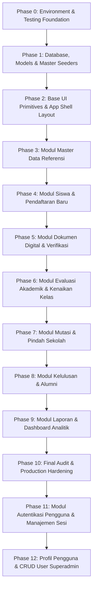

# ROADMAP PENGEMBANGAN SISTEM & AUTENTIKASI PENGGUNA

## MODUL MANAJEMEN SISWA - SMP KRISTEN 1 WONOSOBO

> **Status Dokumen**: Active Engineering Roadmap  
> **Teknologi**: Laravel 12+, Inertia.js v3, Vue 3 (`<script setup lang="ts">`), Tailwind CSS v4, TypeScript, MySQL, Pest PHP  
> **Referensi Desain**: Tema Biru-Putih SMP Kristen 1 Wonosobo (`resources/css/app.css`, [AGENTS.md](file:///home/nocturn/Projects/Basis%20Data%20Terapan/modul-manajemen-siswa/AGENTS.md))  
> **Dokumen Terkait**: [`.docs/ROADMAP_IMPLEMENTASI_DAN_PENGUJIAN.md`](file:///home/nocturn/Projects/Basis%20Data%20Terapan/modul-manajemen-siswa/.docs/ROADMAP_IMPLEMENTASI_DAN_PENGUJIAN.md)

---

## 1. IKHTISAR ROADMAP & MATRIKS FASE PENGEMBANGAN

Berikut adalah peta jalan terpadu modul manajemen siswa, termasuk fase baru penambahan sistem autentikasi akun (_Username & Password_) dan manajemen sesi login terproteksi:



### Tabel Status Kemajuan Fase

|  Fase  | Modul / Sub-Sistem                        | Status  | Lingkup Utama                                                                                              |
| :----: | :---------------------------------------- | :-----: | :--------------------------------------------------------------------------------------------------------- |
| **0**  | Environment & Testing Setup               | Selesai | Pest PHP, SQLite/MySQL in-memory config                                                                    |
| **1**  | Database 15 Tabel, Model & Seeder         | Selesai | 15 Migration ERD, Eloquent Model, Seeders & 20 tests                                                       |
| **2**  | Base UI Primitives & App Shell            | Selesai | 12 Atomic UI Components, AppLayout, Sidebar Biru-Putih                                                     |
| **3**  | Modul Master Data Referensi               | Selesai | CRUD Agama, Rombel Kelas, Tahun Ajaran, Jenis Dokumen                                                      |
| **4**  | Modul Siswa & Pendaftaran Baru            | Selesai | ACID Transaction Siswa, Keluarga, Ortu, Kontak, Dokumen                                                    |
| **5**  | Modul Dokumen Digital Siswa               | Selesai | Upload berkas, queue review TU, verifikasi status berkas                                                   |
| **6**  | Evaluasi Akademik & Kenaikan Kelas        | Selesai | Evaluasi naik/tinggal kelas per rombel, proteksi tingkat 9                                                 |
| **7**  | Modul Mutasi & Pindah Sekolah             | Selesai | Surat mutasi masuk/keluar, siswa pindah sekolah, auto-status                                               |
| **8**  | Modul Kelulusan & Alumni                  | Selesai | Pengesahan ijazah kelas 9, direktori pelacakan alumni                                                      |
| **9**  | Modul Laporan & Dashboard                 | Selesai | Rekap metrik eksekutif, 4 format laporan, cetak kop sekolah                                                |
| **10** | QA, Linting & Security Hardening          | Selesai | 105 Pest tests passed, `vue-tsc` 0 error, Pint clean                                                       |
| **11** | **Autentikasi Pengguna & Manajemen Sesi** | Selesai | **Login Username & Password, Proteksi Route, Redirect `/`, 118 tests PASSED**                              |
| **12** | **Profil & Manajemen User Superadmin**    | Selesai | **Profile Update (No Role Escalation), Kolom Role, Sidebar Group Superadmin, CRUD User, 135 tests PASSED** |

---

## 2. ROADMAP PHASE 11: MODUL AUTENTIKASI PENGGUNA & MANAJEMEN SESI

### 2.1. Tujuan & Sasaran Bisnis

1. Mengamankan seluruh modul administratif SIAKAD SMP Kristen 1 Wonosobo agar hanya dapat diakses oleh staf Tata Usaha dan Admin berwenang.
2. Mengubah mekanisme login standar menjadi menggunakan **`username` dan `password`** (bukan email).
3. Menerapkan proteksi rute global:
    - Jika pengguna mengakses root URL (`/`) **tanpa session login**, sistem **otomatis me-redirect ke halaman login** (`/login`).
    - Jika pengguna sudah memiliki session aktif, akses ke `/` atau `/login` **otomatis diarahkan ke Dashboard** (`/dashboard`).
    - Semua modul fungsional (`/siswa`, `/dokumen`, `/akademik`, `/mutasi`, `/kelulusan`, `/alumni`, `/laporan`, `/master`) wajib terproteksi middleware `auth`.
4. Menyediakan antarmuka login yang modern, profesional, bertema Biru-Putih SMP Kristen 1 Wonosobo, serta mekanisme logout yang aman.

---

### 2.2. Spesifikasi Teknis Basis Data (Tabel `users`)

#### 1. Penambahan Kolom `username`

Menambahkan kolom `username` pada tabel `users` dengan atribut:

- Tipe Data: `VARCHAR(50)`
- Sifat: `UNIQUE`, `NOT NULL`, berindeks (`index`)
- Posisi: setelah kolom `id` atau `name`

```
Tabel: users
├── id (bigint, PK, Auto Increment)
├── name (varchar(100), Not Null)
├── username (varchar(50), Unique, Not Null, Index)  <-- [KOLOM BARU]
├── email (varchar(100), Unique, Nullable/Not Null)
├── email_verified_at (timestamp, Nullable)
├── password (varchar(255), Not Null, Hash Bcrypt/Argon2)
├── remember_token (varchar(100), Nullable)
└── timestamps (created_at, updated_at)
```

#### 2. Migrasi Database

- Membuat file migrasi: `database/migrations/2026_01_01_000016_add_username_to_users_table.php` (atau modifikasi migrasi awal `0001_01_01_000000_create_users_table.php`).
- Definisi skema:
    ```php
    Schema::table('users', function (Blueprint $table) {
        $table->string('username', 50)->unique()->after('name');
    });
    ```

#### 3. Pembaruan Model `app/Models/User.php`

- Tambahkan `username` ke properti `#[Fillable(['name', 'username', 'email', 'password'])]`.
- Tambahkan anotasi PHPDoc `@property string $username`.

#### 4. Pembaruan Seeder & Factory

- `database/seeders/DatabaseSeeder.php`:
  Memperbarui pembuatan akun Administrator Tata Usaha default:
    - **Username**: `admin`
    - **Nama**: `Admin Tata Usaha SMP Kristen 1`
    - **Email**: `admin@smpkristen1wonosobo.sch.id`
    - **Password**: `password123` (di-hash)
- `database/factories/UserFactory.php`:
  Menambahkan `username => fake()->unique()->userName()`.

---

### 2.3. Spesifikasi Rute & Logika Pengalihan (_Routing & Redirection_)

#### Matriks Perilaku Rute:

| Path URL       | HTTP Method |       Middleware        | Kondisi Pengguna    | Aksi / Hasil Pengalihan                                         |
| :------------- | :---------: | :---------------------: | :------------------ | :-------------------------------------------------------------- |
| `/`            |    `GET`    |          `web`          | Belum Login (Guest) | **Redirect 302 ke `/login`**                                    |
| `/`            |    `GET`    |      `web`, `auth`      | Sudah Login (Auth)  | **Redirect 302 ke `/dashboard`**                                |
| `/login`       |    `GET`    |         `guest`         | Belum Login         | Tampilkan Halaman Login (`Auth/Login.vue`)                      |
| `/login`       |    `GET`    |         `guest`         | Sudah Login         | Redirect ke `/dashboard`                                        |
| `/login`       |   `POST`    | `guest`, `throttle:5,1` | Belum Login         | Validasi `username` & `password`, buat session baru             |
| `/logout`      |   `POST`    |         `auth`          | Sudah Login         | Invalidate session, regenerate CSRF token, redirect ke `/login` |
| `/dashboard`   |    `GET`    |         `auth`          | Sudah Login         | Tampilkan Dashboard Eksekutif                                   |
| `/siswa/*`     |     ALL     |         `auth`          | Belum Login         | Redirect ke `/login` dengan menyimpan intended URL              |
| `/dokumen/*`   |     ALL     |         `auth`          | Belum Login         | Redirect ke `/login` dengan menyimpan intended URL              |
| `/akademik/*`  |     ALL     |         `auth`          | Belum Login         | Redirect ke `/login` dengan menyimpan intended URL              |
| `/mutasi/*`    |     ALL     |         `auth`          | Belum Login         | Redirect ke `/login` dengan menyimpan intended URL              |
| `/kelulusan/*` |     ALL     |         `auth`          | Belum Login         | Redirect ke `/login` dengan menyimpan intended URL              |
| `/alumni/*`    |     ALL     |         `auth`          | Belum Login         | Redirect ke `/login` dengan menyimpan intended URL              |
| `/laporan/*`   |     ALL     |         `auth`          | Belum Login         | Redirect ke `/login` dengan menyimpan intended URL              |
| `/master/*`    |     ALL     |         `auth`          | Belum Login         | Redirect ke `/login` dengan menyimpan intended URL              |

---

### 2.4. Arsitektur Komponen Backend

#### 1. Form Request: `app/Http/Requests/Auth/LoginRequest.php`

- Aturan Validasi:
    ```php
    public function rules(): array
    {
        return [
            'username' => ['required', 'string'],
            'password' => ['required', 'string'],
            'remember' => ['nullable', 'boolean'],
        ];
    }
    ```
- Pesan Validasi Khusus Bahasa Indonesia:
    - `'username.required' => 'Username wajib diisi.'`
    - `'password.required' => 'Kata sandi wajib diisi.'`
- Logika Rate Limiting (Anti Brute-Force):
    - Maksimal 5 percobaan gagal berturut-turut per IP dalam kurun 1 menit (`RateLimiter::hit()`, `RateLimiter::clear()`).
    - Melempar `ValidationException` dengan pesan: _"Terlalu banyak percobaan masuk. Silakan coba kembali dalam :seconds detik."_

#### 2. Controller: `app/Http/Controllers/Auth/AuthenticatedSessionController.php`

- Method `create()`:
    - Mengembalikan render Inertia `Auth/Login.vue`.
- Method `store(LoginRequest $request)`:
    - Mengautentikasi kredensial:
        ```php
        if (! Auth::attempt($request->only('username', 'password'), $request->boolean('remember'))) {
            RateLimiter::hit($this->throttleKey($request));
            throw ValidationException::withMessages([
                'username' => __('auth.failed'),
            ]);
        }

        $request->session()->regenerate();
        RateLimiter::clear($this->throttleKey($request));
        return redirect()->intended(route('dashboard'));
        ```
- Method `destroy(Request $request)`:
    - Logout guard web:
        ```php
        Auth::guard('web')->logout();
        $request->session()->invalidate();
        $request->session()->regenerateToken();
        return redirect()->route('login')->with('info', 'Anda telah berhasil keluar dari sistem.');
        ```

#### 3. Middleware Pengalihan Root (`/`)

- Pada `routes/web.php`:
    ```php
    Route::get('/', function () {
        return auth()->check()
            ? redirect()->route('dashboard')
            : redirect()->route('login');
    })->name('root');
    ```

#### 4. Penyampaian Data Sesi (`HandleInertiaRequests.php`)

- Membagikan objek `auth.user` secara reaktif:
    ```php
    'auth' => [
        'user' => $request->user() ? [
            'id' => $request->user()->id,
            'name' => $request->user()->name,
            'username' => $request->user()->username,
            'email' => $request->user()->email,
        ] : null,
    ],
    ```

---

### 2.5. Antarmuka Frontend (UI/UX Tema Biru-Putih)

#### 1. Halaman Login: `resources/js/pages/Auth/Login.vue` (< 150 baris)

- **Komposisi Visual**:
    - Latar belakang gradien lembut `surface-ground` dengan ornamen aksen radial `primary-100/50`.
    - Kartu login elegan berpusat di tengah dengan border halus `border-border-subtle` dan elevasi shadow modern.
    - Lambang identitas resmi SMP Kristen 1 Wonosobo di bagian atas.
    - Judul: _"Sistem Informasi Manajemen Siswa"_.
    - Subjudul: _"SMP Kristen 1 Wonosobo • Masuk untuk mengelola data akademik"_.
- **Elemen Input Form**:
    - Field `username`:
        - Label "Username / ID Pengguna"
        - Ikon user di sisi kiri input
        - Autofocus aktif saat halaman dibuka
        - Error feedback bertema merah tegas jika tidak cocok
    - Field `password`:
        - Label "Kata Sandi"
        - Ikon gembok di sisi kiri
        - Tombol toggle tampilkan/sembunyikan kata sandi (mata terbuka/tertutup)
    - Opsi "Ingat Saya" (_Remember Me Checkbox_).
    - Tombol Submit "Masuk ke Sistem" (`Button variant="primary"`):
        - Status loading spinner saat request diproses.
        - Disabled state saat sedang mengirimkan formulir.
    - Banner peringatan (`Alert.vue`) jika kredensial tidak cocok atau akun terkena batasan waktu percobaan.

#### 2. Integrasi Aksi Logout pada App Shell

- **`resources/js/components/common/Navbar.vue`**:
    - Menampilkan nama staf (`user.name`) dan username (`@user.username`).
    - Dropdown profil / tombol cepat "Keluar" berikon `arrow-right-on-rectangle`.
- **`resources/js/components/common/Sidebar.vue`**:
    - Tombol aksi "Keluar Sistem" pada bagian footer sidebar.
    - Memanggil modal dialog konfirmasi (`ConfirmDialog.vue`): _"Apakah Anda yakin ingin mengakhiri sesi kerja saat ini?"_.
    - Melakukan `router.post('/logout')` saat disetujui.

---

### 2.6. Strategi Pengujian Otomatis (Pest Testing Suite)

Pengujian harus mencakup 100% skenario positif, negatif, dan keamanan pembatasan sesi:

#### Test File: `tests/Feature/Auth/AuthenticationTest.php`

1. [x] **Render Halaman Login**:
    - `it('renders the login page for guests')` -> Tamu dapat membuka `/login` dengan status HTTP 200.
2. [x] **Pengalihan Rute Root Tanpa Session**:
    - `it('redirects unauthenticated users from root / to /login')` -> Tamu mengakses `/` mendapatkan HTTP 302 ke `/login`.
3. [x] **Pengalihan Rute Root Dengan Session**:
    - `it('renders dashboard for authenticated users visiting root /')` -> User terotentikasi mengakses `/` mendapatkan HTTP 200 dan render Dashboard.
4. [x] **Pengalihan Halaman Login Bagi User yang Sudah Login**:
    - `it('redirects authenticated users from /login to /dashboard')` -> User yang sudah login tidak dapat membuka form login kembali.
5. [x] **Proteksi Seluruh Modul Terproteksi**:
    - `it('protects management routes from unauthenticated access')` -> Akses langsung ke `/siswa`, `/dokumen`, `/akademik/kenaikan-kelas`, `/mutasi`, `/kelulusan`, `/alumni`, `/laporan`, `/master/kelas` tanpa login otomatis dialihkan ke `/login`.
6. [x] **Autentikasi Sukses Menggunakan Username & Password**:
    - `it('authenticates users using valid username and password')` -> Pengguna memasukkan `username: 'admin'` dan `password: 'password123'`, session dibuat, redirect ke intended route / dashboard.
7. [x] **Penolakan Kredensial Salah**:
    - `it('rejects invalid password')` -> Pengguna memasukkan kata sandi salah, autentikasi ditolak, session tidak terbentuk, error validation muncul.
    - `it('rejects nonexistent username')` -> Pengguna memasukkan username tidak terdaftar, autentikasi ditolak.
8. [x] **Proteksi Anti Brute-Force (Rate Limiting)**:
    - `it('throttles excessive failed login attempts')` -> Percobaan login salah lebih dari 5 kali memicu penguncian sementara (HTTP 429 atau pesan throttling).
9. [x] **Logout & Pembersihan Sesi**:
    - `it('logs user out and clears session')` -> Mengirim `POST /logout`, status autentikasi menjadi null, session di-invalidate, redirect ke `/login`.

#### Test File: `tests/Unit/UserTest.php`

1. [x] **Keunikan Username**:
    - `it('requires a unique username in database')` -> Percobaan membuat dua user dengan username sama ditolak oleh database constraint.
2. [x] **Validasi Admin Seeder**:
    - `it('seeds default admin with proper username and hashed password')` -> Seeder menghasilkan user dengan `username: 'admin'` yang dapat diverifikasi oleh `Hash::check()`.

---

### 2.7. Checklist Rencana Kerja Eksekusi (Implementation Steps)

- [x] **Langkah 1: Database & Model User**
    - Buat migrasi penambahan kolom `username` di tabel `users`.
    - Update `$fillable` dan PHPDoc di `app/Models/User.php`.
    - Update `DatabaseSeeder.php` dengan akun default `username: 'admin'`.
    - Update `UserFactory.php`.
    - Jalankan `php artisan migrate`.

- [x] **Langkah 2: Validasi & Form Request**
    - Buat `app/Http/Requests/Auth/LoginRequest.php` dengan aturan username & password.
    - Implementasikan helper rate limiting throttle.

- [x] **Langkah 3: Controller & Rute Web**
    - Buat `app/Http/Controllers/Auth/AuthenticatedSessionController.php` (`create`, `store`, `destroy`).
    - Modifikasi `routes/web.php`:
        - Rute `/` diarahkan ke login jika belum ada session, atau ke dashboard jika ada session.
        - Kelompokkan rute login di bawah `middleware('guest')`.
        - Bungkus seluruh rute modul siswa, dokumen, akademik, mutasi, kelulusan, alumni, laporan, dan master di bawah `middleware('auth')`.

- [x] **Langkah 4: Antarmuka Login (`resources/js/pages/Auth/Login.vue`)**
    - Rancang form login bertema Biru-Putih SMP Kristen 1 Wonosobo.
    - Integrasikan komponen `Input.vue`, `Button.vue`, `Alert.vue`.
    - Tambahkan toggle show/hide password dan status loading submit.

- [x] **Langkah 5: Integrasi Aksi Logout pada App Shell**
    - Perbarui `resources/js/components/common/Navbar.vue` (tampilkan `@username` & tombol logout).
    - Perbarui `resources/js/components/common/Sidebar.vue` (tombol logout di footer).

- [x] **Langkah 6: Penyusunan Test Suite & Verifikasi**
    - Tulis `tests/Feature/Auth/AuthenticationTest.php` (11 skenario uji).
    - Tulis `tests/Unit/UserTest.php` (2 skenario uji).
    - Jalankan `php artisan test --filter=Auth` dan seluruh test suite `php artisan test` (118 tests PASSED).

- [x] **Langkah 7: Audit Kualitas Kode & Formatting**
    - Jalankan `npm run types:check` (`vue-tsc --noEmit`).
    - Jalankan `npm run check`.
    - Jalankan `vendor/bin/pint`.

---

## 3. ROADMAP PHASE 12: MANAJEMEN PROFIL PENGGUNA & KONTROL AKSES SUPERADMIN

### 3.1. Tujuan & Sasaran Bisnis

1. **Pembaruan Profil Mandiri (Self-Service Profile Update)**:
    - Setiap pengguna yang terautentikasi (baik Superadmin maupun Staf Admin TU) dapat memperbarui data identitas dirinya sendiri (`name`, `username`, `email`) serta mengganti kata sandinya secara aman.
    - **Prinsip Keamanan Tanpa Eskalasi Hak Akses (Zero Role Escalation)**:
        - Pengguna **hanya dapat memperbarui informasi dirinya sendiri tanpa mengubah role/peran**.
        - Kolom `role` ditiadakan dari formulir pembaruan profil di sisi frontend dan dijaga ketat di sisi backend agar tidak dapat dimodifikasi melalui request update profile (mencegah eksploitasi eskalasi hak istimewa).
2. **Sistem Peran Pengguna (Role-Based Access Control / RBAC)**:
    - Menambahkan kolom `role` pada tabel `users` dengan nilai enum: `'superadmin'` dan `'admin'`.
    - Default role bagi pengguna baru adalah `'admin'`.
    - Hanya `'superadmin'` yang memiliki hak istimewa untuk mengelola pengguna (CRUD User).
3. **Pengelompokan Navigasi Baru di Sidebar Khusus Superadmin**:
    - Menambahkan kelompok menu navigasi baru di `Sidebar.vue` bertajuk **"Administrasi Sistem"**.
    - Menu ini **hanya dirender secara kondisional jika `user.role === 'superadmin'`**.
    - Tautan menu: **"Kelola Pengguna"** mengarah ke `/admin/users`.
4. **CRUD Pengguna Lengkap Bagi Superadmin**:
    - Superadmin dapat melihat daftar seluruh user, menyaring pencarian nama/username/email/role.
    - Superadmin dapat menambah akun pengguna baru (menentukan peran `superadmin` atau `admin`).
    - Superadmin dapat mengubah data akun pengguna lain (termasuk reset kata sandi dan perubahan peran).
    - Superadmin dapat menghapus akun pengguna lain dengan proteksi pencegahan hapus diri sendiri (_self-deletion prevention_) dan proteksi pencegahan penghapusan akun superadmin terakhir.

---

### 3.2. Spesifikasi Teknis Basis Data (Tabel `users`)

#### 1. Penambahan Kolom `role`

Menambahkan kolom `role` pada tabel `users` dengan atribut:

- Tipe Data: `ENUM('superadmin', 'admin')`
- Nilai Default: `'admin'`
- Sifat: `NOT NULL`, berindeks (`index`)
- Posisi: setelah kolom `username`

```
Tabel: users
├── id (bigint, PK, Auto Increment)
├── name (varchar(100), Not Null)
├── username (varchar(50), Unique, Not Null, Index)
├── role (enum('superadmin', 'admin'), Default: 'admin', Index)  <-- [KOLOM BARU]
├── email (varchar(100), Unique, Nullable/Not Null)
├── email_verified_at (timestamp, Nullable)
├── password (varchar(255), Not Null, Hash Bcrypt/Argon2)
├── remember_token (varchar(100), Nullable)
└── timestamps (created_at, updated_at)
```

#### 2. Migrasi Database

- File Migrasi: `database/migrations/2026_01_01_000017_add_role_to_users_table.php`
- Definisi skema:
    ```php
    Schema::table('users', function (Blueprint $table) {
        $table->enum('role', ['superadmin', 'admin'])->default('admin')->after('username')->index();
    });
    ```

#### 3. Pembaruan Model `app/Models/User.php`

- Tambahkan `role` ke properti `#[Fillable(['name', 'username', 'role', 'email', 'password'])]`.
- Tambahkan anotasi PHPDoc `@property string $role`.
- Tambahkan helper method:
    ```php
    public function isSuperadmin(): bool
    {
        return $this->role === 'superadmin';
    }

    public function isAdmin(): bool
    {
        return $this->role === 'admin';
    }
    ```

#### 4. Pembaruan Seeder & Factory

- `database/seeders/DatabaseSeeder.php`:
    - Akun Superadmin:
        - **Username**: `superadmin`
        - **Nama**: `Super Administrator SMP Kristen 1`
        - **Role**: `superadmin`
        - **Email**: `superadmin@smpkristen1wonosobo.sch.id`
        - **Password**: `password123`
    - Akun Admin TU:
        - **Username**: `admin`
        - **Nama**: `Admin Tata Usaha SMP Kristen 1`
        - **Role**: `admin`
        - **Email**: `admin@smpkristen1wonosobo.sch.id`
        - **Password**: `password123`
- `database/factories/UserFactory.php`:
    - Default: `'role' => 'admin'`
    - State:
        ```php
        public function superadmin(): static
        {
            return $this->state(fn (array $attributes) => [
                'role' => 'superadmin',
            ]);
        }
        ```

#### 5. Pembaruan TypeScript Interface (`resources/js/types/auth.ts`)

```ts
export type UserRole = 'superadmin' | 'admin';

export type User = {
    id: number;
    name: string;
    username: string;
    role: UserRole;
    email: string;
    avatar?: string;
    email_verified_at: string | null;
    created_at: string;
    updated_at: string;
    [key: string]: unknown;
};
```

---

### 3.3. Spesifikasi Rute & Matriks Otorisasi

| Path URL              | HTTP Method |        Middleware        | Otorisasi        | Aksi / Deskripsi                                            |
| :-------------------- | :---------: | :----------------------: | :--------------- | :---------------------------------------------------------- |
| `/profile`            |    `GET`    |          `auth`          | Semua User Login | Tampilkan halaman edit profil pribadi (`Profile/Edit.vue`)  |
| `/profile`            |   `PATCH`   |          `auth`          | Semua User Login | Simpan pembaruan identitas (`name`, `username`, `email`)    |
| `/profile/password`   |    `PUT`    |          `auth`          | Semua User Login | Perbarui kata sandi dengan verifikasi kata sandi lama       |
| `/admin/users`        |    `GET`    | `auth`, `can:superadmin` | Superadmin Saja  | Tampilkan tabel daftar seluruh pengguna (`Users/Index.vue`) |
| `/admin/users`        |   `POST`    | `auth`, `can:superadmin` | Superadmin Saja  | Tambah akun pengguna baru beserta peran                     |
| `/admin/users/{user}` |    `PUT`    | `auth`, `can:superadmin` | Superadmin Saja  | Perbarui data akun, peran, dan reset password               |
| `/admin/users/{user}` |  `DELETE`   | `auth`, `can:superadmin` | Superadmin Saja  | Hapus akun pengguna (proteksi _anti self-delete_)           |

---

### 3.4. Arsitektur Komponen Backend

#### 1. Definisi Gate Otorisasi (`bootstrap/app.php` atau `AppServiceProvider.php`)

```php
Gate::define('superadmin', function (User $user) {
    return $user->isSuperadmin();
});
```

#### 2. Form Requests

- **`app/Http/Requests/Profile/UpdateProfileRequest.php`**:
    - `name`: `['required', 'string', 'max:100']`
    - `username`: `['required', 'string', 'max:50', 'alpha_dash', Rule::unique(User::class)->ignore($this->user()->id)]`
    - `email`: `['required', 'email', 'max:100', Rule::unique(User::class)->ignore($this->user()->id)]`
    - _Catatan Keamanan_: Menolak / menghapus field `role` dari payload sebelum diproses.
- **`app/Http/Requests/Profile/UpdatePasswordRequest.php`**:
    - `current_password`: `['required', 'current_password']`
    - `password`: `['required', 'confirmed', Password::defaults()]`
- **`app/Http/Requests/Admin/StoreUserRequest.php`**:
    - `name`: `['required', 'string', 'max:100']`
    - `username`: `['required', 'string', 'max:50', 'alpha_dash', 'unique:users,username']`
    - `email`: `['required', 'email', 'max:100', 'unique:users,email']`
    - `password`: `['required', Password::defaults()]`
    - `role`: `['required', 'in:superadmin,admin']`
- **`app/Http/Requests/Admin/UpdateUserRequest.php`**:
    - `name`: `['required', 'string', 'max:100']`
    - `username`: `['required', 'string', 'max:50', 'alpha_dash', Rule::unique(User::class)->ignore($this->route('user'))]`
    - `email`: `['required', 'email', 'max:100', Rule::unique(User::class)->ignore($this->route('user'))]`
    - `password`: `['nullable', Password::defaults()]`
    - `role`: `['required', 'in:superadmin,admin']`

#### 3. Controllers

- **`app/Http/Controllers/ProfileController.php`**:
    - `edit()`: Render `Profile/Edit.vue` dengan data pengguna saat ini.
    - `update(UpdateProfileRequest $request)`: Simpan perubahan `name`, `username`, `email` milik `$request->user()`.
    - `updatePassword(UpdatePasswordRequest $request)`: Update password ter-hash, kirim flash sukses.
- **`app/Http/Controllers/Admin/UserController.php`**:
    - `index(Request $request)`: Query daftar pengguna terpaginasi dengan pencarian nama/username/email dan filter role.
    - `store(StoreUserRequest $request)`: Simpan user baru dengan password ter-hash.
    - `update(UpdateUserRequest $request, User $user)`: Perbarui data user dan role.
    - `destroy(Request $request, User $user)`:
        - Cegah hapus diri sendiri: `if ($user->id === $request->user()->id) { throw ValidationException... }`
        - Cegah hapus superadmin terakhir jika hanya ada 1 superadmin.
        - Hapus record user.

---

### 3.5. Arsitektur Komponen Frontend (UI/UX Tema Biru-Putih)

#### 1. Halaman Profil Pengguna (`resources/js/pages/Profile/`)

- **`Edit.vue`** (< 120 baris - Orchestrator):
    - Menggabungkan sub-komponen kartu form secara modular.
    - PageHeader: "Pengaturan Profil" dan subtitle "Kelola informasi akun dan kata sandi Anda".
- **`UpdateProfileInformationCard.vue`** (< 150 baris):
    - Form input: `Nama Lengkap`, `Username`, `Email`.
    - Input `role` **TIDAK DITAMPILKAN** (hanya badge role non-editable / read-only).
    - Tombol simpan dengan status loading dan alert pesan sukses.
- **`UpdatePasswordCard.vue`** (< 150 baris):
    - Form input: `Kata Sandi Saat Ini`, `Kata Sandi Baru`, `Konfirmasi Kata Sandi`.
    - Toggle visibilitas kata sandi.
    - Tombol perbarui kata sandi dengan feedback error/sukses.

#### 2. Penambahan Akses Profil pada App Shell (`Navbar.vue`)

- Pada avatar / profile block di `Navbar.vue`:
    - Tampilkan badge role kecil (`Superadmin` / `Tata Usaha`).
    - Tambahkan tombol pintasan "Profil Saya" yang mengarahkan ke `/profile`.

#### 3. Grouping Baru pada Sidebar (`Sidebar.vue`)

- Tambahkan blok grup menu baru:
    ```html
    <!-- Khusus Hak Akses Superadmin -->
    <div v-if="user.role === 'superadmin'" class="space-y-1">
        <p class="text-2xs mb-2 px-2.5 font-semibold tracking-wider text-primary-300/80 uppercase">
            Administrasi Sistem
        </p>
        <Link
            href="/admin/users"
            class="..."
            :class="[isActive('/admin/users') ? 'bg-primary-800 ...' : '...']"
        >
            <!-- Icon Shield / User Group -->
            <span>Kelola Pengguna</span>
        </Link>
    </div>
    ```

#### 4. Halaman Manajemen Pengguna Superadmin (`resources/js/pages/Users/`)

- **`Index.vue`** (< 150 baris):
    - Tabel pengguna terpaginasi (ID, Nama, Username, Email, Peran dengan Badge semantik: Superadmin = Ungu/Navy, Admin = Biru Laut, Tanggal Dibuat, Aksi).
    - Filter bar pencarian nama / username / email & dropdown filter peran.
    - Tombol "Tambah Pengguna".
- **`UserModal.vue`** (< 160 baris):
    - Modal form untuk Tambah dan Edit Pengguna.
    - Input: Nama, Username, Email, Peran (`Superadmin` / `Admin TU`), Kata Sandi (Wajib saat tambah, opsional saat edit).
- Konfirmasi hapus pengguna menggunakan `ConfirmDialog.vue`.

---

### 3.6. Strategi Pengujian Otomatis (Pest Testing Suite)

#### 1. Unit Tests (`tests/Unit/UserRoleTest.php`)

- [x] `it('assigns default role admin to new users')`: Pembuatan user baru secara default memiliki `role === 'admin'`.
- [x] `it('checks superadmin status using isSuperadmin helper')`: `$user->isSuperadmin()` mengembalikan `true` hanya untuk role superadmin.
- [x] `it('checks admin status using isAdmin helper')`: `$user->isAdmin()` mengembalikan `true` hanya untuk role admin.
- [x] `it('seeds both superadmin and admin default users')`: Verifikasi seeders menghasilkan akun `superadmin` dan `admin`.

#### 2. Feature Tests - Profil Pengguna (`tests/Feature/Profile/ProfileTest.php`)

- [x] `it('renders the profile edit page for authenticated users')`: User dapat mengakses `GET /profile` dengan status 200.
- [x] `it('updates profile information successfully')`: User dapat memperbarui nama, username, dan email miliknya.
- [x] `it('prevents user from updating their own role via profile update')`: Upaya menyisipkan `role: 'superadmin'` dalam payload `/profile` tidak mengubah role user di database.
- [x] `it('validates unique username and email ignoring own id')`: Username/email sama milik diri sendiri diterima, namun duplikasi milik orang lain ditolak.
- [x] `it('updates password with valid current password')`: Password berhasil diperbarui saat `current_password` valid.
- [x] `it('rejects password update with incorrect current password')`: Gagal perbarui kata sandi jika kata sandi lama salah.

#### 3. Feature Tests - Manajemen User Superadmin (`tests/Feature/Admin/UserManagementTest.php`)

- [x] `it('denies access to user management for non-superadmin users')`: Admin biasa mengakses `GET /admin/users` mendapatkan HTTP 403 Forbidden.
- [x] `it('redirects guests to login when accessing user management')`: Tamu mengakses `/admin/users` diredirect ke `/login`.
- [x] `it('allows superadmin to view list of users')`: Superadmin dapat membuka `GET /admin/users` dengan status 200.
- [x] `it('allows superadmin to create a new user with specific role')`: Superadmin dapat membuat user baru dengan role `admin` atau `superadmin`.
- [x] `it('allows superadmin to update user details and role')`: Superadmin dapat mengubah data akun dan peran user lain.
- [x] `it('prevents superadmin from deleting their own account')`: Percobaan Superadmin menghapus akunnya sendiri ditolak dengan validasi error.
- [x] `it('allows superadmin to delete another user')`: Superadmin berhasil menghapus akun user lain.

---

### 3.7. Checklist Rencana Kerja Eksekusi (Implementation Steps)

- [x] **Langkah 1: Migrasi Kolom `role` & Pembaruan Model `User`**
    - Buat migrasi `2026_01_01_000017_add_role_to_users_table.php`.
    - Update `app/Models/User.php` (`$fillable`, `isSuperadmin()`, `isAdmin()`).
    - Update `DatabaseSeeder.php` & `UserFactory.php`.
    - Update TypeScript types di `resources/js/types/auth.ts`.
    - Jalankan migrasi.

- [x] **Langkah 2: Otorisasi & Gate Superadmin**
    - Definisikan Gate `superadmin` di `bootstrap/app.php` atau `AppServiceProvider.php`.
    - Pastikan `user.role` tershare via `HandleInertiaRequests.php`.

- [x] **Langkah 3: Backend Profil Pengguna**
    - Buat `UpdateProfileRequest.php` & `UpdatePasswordRequest.php`.
    - Buat `ProfileController.php` (`edit`, `update`, `updatePassword`).
    - Daftarkan rute `/profile` di `routes/web.php`.

- [x] **Langkah 4: Backend Manajemen User Superadmin**
    - Buat `StoreUserRequest.php` & `UpdateUserRequest.php`.
    - Buat `UserController.php` (`index`, `store`, `update`, `destroy`).
    - Daftarkan rute grup `/admin/users` di bawah `can:superadmin` di `routes/web.php`.

- [x] **Langkah 5: Frontend Halaman Profil**
    - Buat `resources/js/pages/Profile/Edit.vue`.
    - Buat `UpdateProfileInformationCard.vue` & `UpdatePasswordCard.vue`.
    - Tambahkan link "Profil Saya" di `Navbar.vue`.

- [x] **Langkah 6: Frontend Sidebar Grouping & Halaman User**
    - Tambahkan blok grup `Administrasi Sistem` di `Sidebar.vue` (kondisional `user.role === 'superadmin'`).
    - Buat `resources/js/pages/Users/Index.vue` & `UserModal.vue`.

- [x] **Langkah 7: Test Suite Pest PHP & Hardening**
    - Tulis `tests/Unit/UserRoleTest.php` (4 skenario).
    - Tulis `tests/Feature/Profile/ProfileTest.php` (6 skenario).
    - Tulis `tests/Feature/Admin/UserManagementTest.php` (7 skenario).
    - Jalankan `php artisan test` (118 tests + 17 tests baru = 135 tests).
    - Jalankan `npm run types:check`, `npm run check`, `vendor/bin/pint`.

---

## 4. PANDUAN PENGEMBANG & STANDAR KODE (DEVELOPMENT GUIDELINES)

1. **Check Before Create**:
   Gunakan komponen input, button, badge, dan modal yang telah tersedia di `resources/js/components/ui/`. Jangan membuat duplikasi style manual.
2. **Anti-Bloat**:
   File `Login.vue`, `Profile/Edit.vue`, `Users/Index.vue` harus padat, bersih, dan ringkas (< 150 baris kode).
3. **Pemisahan Logika**:
   Logika verifikasi dan form validation berada di `FormRequest`, sedangkan controller bertindak tipis mengelola alur sesi, otorisasi, dan respons.
4. **Keamanan Sesi & Otorisasi**:
   Selalu jalankan otorisasi berbasis Gate/Policy untuk melindungi endpoint administratif, dan selalu hindari mass assignment kolom `role` pada endpoint profil mandiri pengguna.
